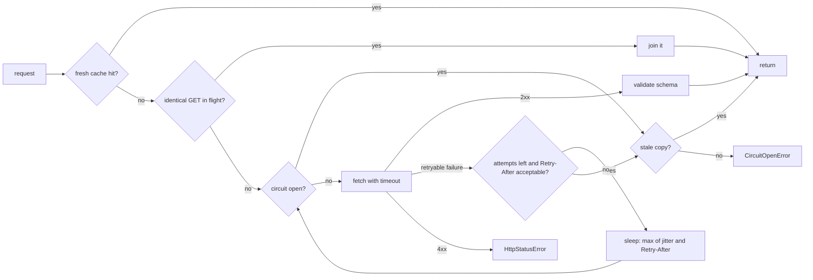

# resilient-http-client

[](https://github.com/ndanetaadmire-debug/axios/actions/workflows/ci.yml)

A small, typed HTTP client built on native `fetch`, for calling third-party APIs that sometimes fail. It has **zero runtime dependencies** (14 kB packed).

```ts
import { createClient } from "resilient-http-client";
import { z } from "zod";

const api = createClient({
  baseUrl: "https://bored-api.appbrewery.com",
  timeoutMs: 4_000,
  retry: { maxAttempts: 3 },                        // jittered exponential backoff; honours Retry-After
  breaker: { failureThreshold: 4, cooldownMs: 20_000 },
  cache: { staleIfError: true },                    // serve the last good answer during an outage
});

const { data } = await api.get("filter", {
  query: { type: "social", participants: 2 },       // always URL-encoded
  schema: z.array(z.object({ activity: z.string(), participants: z.number() })),
  cacheTtlMs: 60_000,
});
data[0]?.activity; // typed from the schema
```

> **Where this came from.** This repo began as my "5.3 Axios" exercise: an Express page that called the Bored API with axios. Its weak spots were form input pasted into the URL, no timeout, no retry, a raw error on every blip and no validation. They're the same weak spots most API integrations have in production. So I turned the exercise into the library I'd want, and rebuilt the original app on it as [`examples/activity-finder`](examples/activity-finder). The original code is in the git history.

## Features

| | |
|---|---|
| **Timeouts** | Per attempt, via `AbortSignal`, combined with the caller's own signal. A caller abort is never retried. |
| **Retries** | Full-jitter exponential backoff. Only idempotent methods are retried by default; a POST or PATCH is retried only when it carries an `idempotencyKey`. Retries 408/425/429/5xx and network errors. `Retry-After` (seconds or HTTP date) is honoured, but the client gives up rather than wait longer than `maxRetryAfterMs`. |
| **Circuit breaker** | One per host: closed → open after N server failures in a window → half-open probe after a cooldown. 4xx responses don't count, because the host is healthy. |
| **Single-flight** | Concurrent identical GETs share one upstream request. |
| **Cache** | Opt-in TTL LRU for GETs, with `staleIfError` to serve the last good response while the upstream is down. The response is marked `stale: true` so the UI can say so. |
| **Validation** | Pass any `{ parse }` schema (Zod, Valibot, ArkType) and `data` is typed from it. A mismatch throws `ResponseValidationError` and isn't retried. |
| **Safe URLs** | Query values are always encoded. Absolute URLs and `../` paths are rejected, so a request can't be redirected to another host along with your auth headers. |
| **Typed errors** | `HttpStatusError` (status, body, headers), `TimeoutError`, `NetworkError`, `AbortedError`, `CircuitOpenError` and `ResponseValidationError`, all extending `HttpClientError`. |
| **Observability** | `onRequest`, `onResponse`, `onRetry` and `onCircuitChange` hooks for logs and metrics. |
| **Testability** | `fetch`, `now`, `sleep` and `random` are injectable, so every timing behaviour is tested deterministically without real waits. |

## How a request flows



Design notes and trade-offs are in [docs/design.md](docs/design.md).

## Run the example

```bash
npm install
npm run example   # http://localhost:3000; set ACTIVITY_API to point at another server
```

## Tests

```bash
npm test          # 38 tests: unit, client behaviour with a scripted fetch, and real fetch against a local server
npm run typecheck
npm run build     # ESM and .d.ts into dist/
```

The integration suite starts a real `node:http` server that can be switched between ok, flaky, slow and down modes. It checks that the example app retries through a flaky upstream, serves saved results during an outage, and then stops calling the upstream once the circuit opens.

## License

MIT © Admire T. Ndaneta
